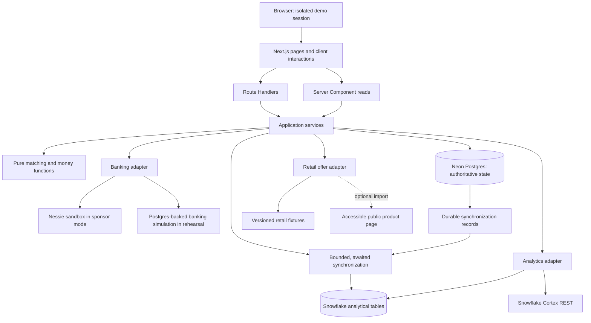
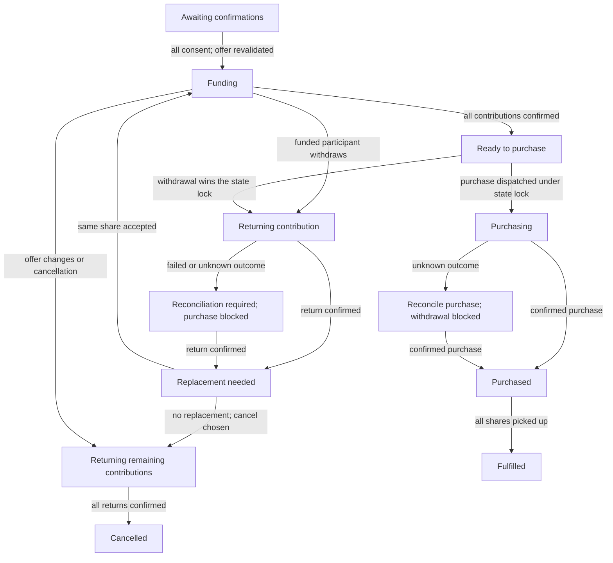

# CommonCart atlas

Status: **implemented locally in rehearsal mode**. The application, migrations and provider adapters exist; no deployment exists and no authenticated sponsor connection has been verified. See [implementation.md](implementation.md#implementation-status).

## Reading map

| Guide | Owns |
| --- | --- |
| [Project brief](PROJECT_BRIEF.md) | Consumer problem, product promise and MVP boundaries |
| [Agent guide](AGENTS.md) | Short instructions that apply across the repository |
| [Implementation guide](implementation.md) | Milestone order, domain contracts, algorithms and acceptance criteria |
| [Conventions](conventions.md) | Code, money, persistence, API and testing rules |
| [Technical context](techContext.md) | Dependency versions, configuration and external API evidence |

## Product map

**Promise:** Get the savings of buying together without needing the whole package or fronting everyone else's money.

The first audience is students and nearby households. The 24-hour demo supports one countable, shelf-stable product per group, one bulk package, a shared pickup zone and time window, and two to six participants. The featured journey starts with a need and includes a funded participant leaving, receiving their mock contribution back, and being replaced.

| Screen | Consumer action | Service responsibility |
| --- | --- | --- |
| Start / persona selector | Start a demo and choose a seeded shopper | Create an isolated session, provision its mock accounts, resolve the active persona |
| Need entry | Choose product, exact quantity, maximum contribution and pickup slot | Validate and persist the need; schedule analytical synchronization |
| Matches | Compare compatible group proposals and personal savings | Synchronize relevant data, query candidates, run deterministic matching |
| Group detail | Inspect allocation and confirm personal terms | Revalidate the proposal, reserve needs, record per-person consent |
| Funding and changes | Contribute, inspect status or withdraw before purchase | Track operations, reconcile funds, return a contribution and refill its slot |
| Pickup summary | See purchased shares and mark pickup | Record pickup per allocation; mark fulfilled after all shares are collected |
| Wallet | See balance, upcoming bills, what is safe to contribute and verified history | Read the Nessie account and bills, derive spendable money, re-read each record from the bank |
| Insights | See community savings, demand and outcomes | Synchronize, run Snowflake SQL (local queries in rehearsal), summarize with Cortex under validation |

Use warm neutral surfaces, green savings accents, readable cards and keyboard-accessible dialogs. Show amount, quantity, data source and next action together. A visible demo label explains simulated shopping/banking; an operator panel exposes provider mode and scenario controls without filling consumer screens with infrastructure details.

## System map



In rehearsal mode the analytics adapter queries local fixture-backed data and returns a deterministic explanation. In sponsor mode analytical queries and explanations call Snowflake. Provider mode is fixed when a session starts; an outage never changes its mode.

## Data ownership and freshness

| Owner | Authoritative for | Not authoritative for |
| --- | --- | --- |
| Postgres | Sessions, personas, normalized offer snapshots, needs, reservations, proposals, consent, allocations, operation records, workflow events and synchronization progress | Whether an external Nessie transaction actually settled |
| Nessie | Sandbox account state and observed transfer/purchase outcomes | Group membership, item inventory, pickup or real escrow |
| Snowflake | Analytical copies, candidate queries and calculated reports over synchronized data | Operational reservations, consent or committing an external payment |
| Retail source | The original fixture or observed public offer, with provenance and timestamp | A guaranteed current checkout total when price, availability or fees are unverified |
| Cortex | Generated explanations of supplied evidence | Prices, arithmetic, eligibility decisions or banking completion |

Postgres writes append synchronization work in the same transaction. Before matching, the service synchronizes the initiating need and relevant offer/candidate snapshot, then queries Snowflake. It records the analytical snapshot used. Selected needs and prices are always revalidated in Postgres before reservation or confirmation. A stale or failed synchronization yields a retryable error in sponsor mode.

Use explicit, awaited service calls and a retryable synchronization command for the MVP. Do not depend on an in-process timer or fire-and-forget task surviving a serverless request.

## Planned module layout

```text
src/
  app/                    pages, layouts and thin API route handlers
  components/             consumer UI, shared primitives and demo controls
  domain/                 types, money, matching and transition rules
  server/
    services/             session, proposal, funding, replacement and pickup workflows
    db/                   Drizzle schema, repositories and transaction helpers
    providers/            retail, banking and analytics contracts/adapters
    observability/        redacted structured logs and request identifiers
fixtures/                 versioned products, offers, personas and scenarios
drizzle/                  reviewed Postgres migration SQL
snowflake/                analytical schema and parameterized query definitions
scripts/                  seed, migration, reconciliation and integration checks
tests/                    domain, database integration and browser scenarios
public/                   local product illustrations and static assets
```

These directories now exist. Additional implementation files: `src/lib/` holds client-safe formatting, view contracts and the API client; `src/server/http.ts` holds the route envelope/origin/cookie helpers; `docker-compose.yml` provides local Postgres 18. Use one application and one package manifest. Vite supports Vitest only; Next.js handles the application build. Database schema evolves through reviewed migrations rather than runtime table creation.

## Funding map



Group status and operation status are separate. A successful HTTP request is not necessarily a completed banking action. Uncertain outcomes remain visible and prevent incompatible transitions. A withdrawal cannot race past a dispatched purchase.

The collection account is unique to a group within a session. Contributions, returns and purchases reference that group; every retained contribution remains attributable to its participant. Account pooling is a sandbox demonstration, not real escrow.

## Deployment and demo boundaries

- Vercel runs the Next.js application on Node 24.x; local development pins Node 24.21.0.
- Neon Postgres 18 supplies durable state through a pooled application connection and a direct migration connection.
- Server-only adapters call Nessie and Snowflake using credentials stored outside source control.
- Each demo session owns its personas, needs, account mappings and operations. Reset creates a new session without deleting prior banking evidence or pretending outstanding returns completed.
- Live retail checkout, real payment processing, actual club-membership verification, multi-product baskets and background marketplace operation are later extensions.

See [implementation.md](implementation.md) for the scenario and acceptance gates and [techContext.md](techContext.md) for exact package pins and integration prerequisites.
